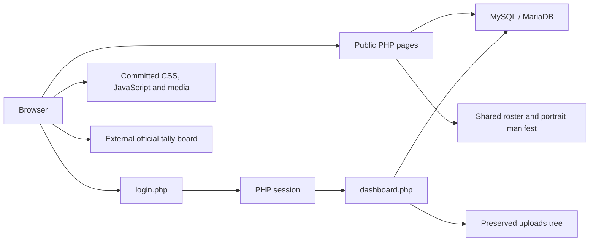

# Comprehensive developer guide

**CSPC Supreme Student Council website**

Reviewed November 23, 2026 · Asia/Taipei

This guide describes the current repository implementation and the supported way
to develop, maintain and deploy it. Start with the [README](../README.md) for a
quick local setup. [OVERHAUL_PLAN.md](../OVERHAUL_PLAN.md) tracks broader work;
[DEPLOYMENT_BASELINE.md](../DEPLOYMENT_BASELINE.md) preserves historical recovery
evidence. Neither historical document is a substitute for inspecting the current code.

## Contents

1. [Architecture and repository map](#architecture-and-repository-map)
2. [Local development](#local-development)
3. [Database and migrations](#database-and-migrations)
4. [Routes, authentication and document storage](#routes-authentication-and-document-storage)
5. [UI and responsive behavior](#ui-and-responsive-behavior)
6. [Content and asset maintenance](#content-and-asset-maintenance)
7. [Tests and verification](#tests-and-verification)
8. [CI and production deployment](#ci-and-production-deployment)
9. [Backups, failure recovery and rollback](#backups-failure-recovery-and-rollback)
10. [Troubleshooting](#troubleshooting)
11. [Known limits and handoff](#known-limits-and-handoff)

## Architecture and repository map

The application is server-rendered vanilla PHP with mysqli and PHP sessions.
Public page scripts query MySQL/MariaDB or load roster arrays, then render shared
PHP includes. Plain JavaScript enhances navigation, forms, dialogs and in-place
filtering. CSS is committed directly; there is no frontend compilation step.



| Location | Responsibility |
| --- | --- |
| Root PHP entry points | Public pages, sign-in, dashboard, PDF viewer/stream, report and legacy attendance route. |
| [includes/head.php](../includes/head.php) | Metadata, shared styles, per-page CSS/JS loading and file-mtime cache keys. |
| [includes/nav.php](../includes/nav.php), [includes/footer.php](../includes/footer.php) | Shared navigation, account state, quick links and contacts. |
| [includes/theme.php](../includes/theme.php) | Active server theme. Currently always `siklab`. |
| [includes/home-siklab.php](../includes/home-siklab.php) | Active Home markup. `home-regular.php` retains the earlier presentation. |
| [includes/officer-rosters.php](../includes/officer-rosters.php) | Versioned academic-year roster arrays. Officer content is not managed in the database. |
| [includes/council-offices.php](../includes/council-offices.php) | Office IDs, full headings, short labels and optional mobile titles. |
| [includes/current-academic-year.php](../includes/current-academic-year.php) | Current roster key and display label. |
| [includes/executive-roles.php](../includes/executive-roles.php), [includes/executive-officers.php](../includes/executive-officers.php) | Exact executive-role list and current Home executive selection. |
| [includes/about-content.php](../includes/about-content.php) | Original platform credits, current-roster identity mappings, histories, cards and profile dialog. |
| [includes/form-security.php](../includes/form-security.php) | Session CSRF token creation and validation for the updated sign-in/dashboard flows. |
| [includes/document-storage.php](../includes/document-storage.php) | Canonical upload resolution and safe cleanup after document deletion. |
| [includes/file-picker.php](../includes/file-picker.php) | Reusable progressive file-selection markup. |
| `assets/css/`, `assets/js/` | Shared and page-specific styles/behavior; retained Flowbite and legacy assets. |
| `assets/img/officers/` | Prepared local portraits, manifest and silhouette fallback. |
| `assets/img/siklab/`, `assets/video/` | Prepared event images and runtime video. |
| `assets/static/` | Supplied branding/backgrounds and locally retained source media. Release exclusions are selective. |
| `config/` | Tracked connection loader/example; ignored machine-specific settings. |
| `database/migrations/` | Ordered local/test schema changes. |
| `scripts/` | Local launcher, database CLI, asset preparation, packager and FTPS deployer. |
| `tests/`, `.github/workflows/` | Behavior/integration/safeguard checks and GitHub automation. |
| `uploads/`, `vendor/`, `node_modules/`, `build/` | User content, generated dependencies and local output. These require different preservation rules; see deployment. |

### Dependencies

`composer.json` requires compatible PHP 8.x starting at 8.3, mysqli, GD, fileinfo,
and TCPDF. Use `composer.lock` when installing. CI uses PHP 8.3, Node 22 and
MariaDB 11.4, with curl and mbstring available alongside the required extensions.

`package-lock.json` locks the npm dependencies, currently Flowbite. `npm ci`
restores packages; it does not rebuild the page CSS or automatically replace
committed vendored assets. Review both the lockfile and served assets during an upgrade.

External runtime services include Google Fonts, Font Awesome/CDN assets, PDF.js,
QRServer, the remaining remotely hosted crest, the attendance iframe and the
official tally board. PDF viewing and QR generation have separate failure paths;
test them independently of ordinary page rendering.

## Local development

### Supported Windows setup

Install PHP 8.3 with mysqli/GD extension binaries and fileinfo, Composer, Python
3.10+, and the XAMPP/MariaDB command-line binaries. Node 22 matches CI. PHP and
Composer must be on PATH; the launcher expects `composer.phar` beside the Composer
launcher. The default MariaDB binary directory is `C:\xampp\mysql\bin`.

From the repository root:

```powershell
python scripts/dev.py doctor
python scripts/dev.py setup
python scripts/dev.py serve
```

If MariaDB is elsewhere, set its binary directory before the first setup:

```powershell
$env:SSC_MYSQL_BIN = 'D:\Tools\MariaDB\bin'
python scripts/dev.py setup
```

The helper stores the selected binary path in private workspace state. Changing
the environment variable afterward does not replace an existing saved instance.
Inspect that state privately when moving a setup rather than deleting its data.

Open `http://127.0.0.1:8000/`. VS Code tasks in [.vscode/tasks.json](../.vscode/tasks.json)
run the same setup/start/stop commands. The launcher binds PHP to loopback, supplies
a private session directory, and enables mysqli/GD per process without changing
the global PHP configuration. It clears inherited DB_* variables for its local commands.

### Data, credentials and lifecycle

Setup creates `ssc_dev` in a dedicated MariaDB instance at `127.0.0.1:33079`, with
a restricted application database user. It writes development settings to ignored
`config/database.local.php` and generated sign-in details to `config/dev.local.json`.
An existing unmanaged connection file is copied into private workspace state first.

| Local account | Application permissions |
| --- | --- |
| `admin@example.test` | Administrator document management and report access. |
| `member@example.test` | Read-only dashboard and authenticated report access. |

Passwords are generated; read them privately from `config/dev.local.json`. Setup
and seeding add missing accounts and fixtures without resetting existing passwords.
Production sign-in credentials do not apply to this local database.

Three synthetic PDFs are stored under `uploads/development/ssc_dev/`. Private
database files, credentials, logs and sessions are under
`%LOCALAPPDATA%\SSCWebsiteDev\<workspace-id>`, where the ID derives from the checkout path.
Do not publish these files or paste them into bug reports.

| Command | Effect |
| --- | --- |
| `python scripts/dev.py start-db` | Start or authenticate the dedicated instance. |
| `python scripts/dev.py status` | Show application table counts. Starts the DB if needed. |
| `python scripts/dev.py migrate` | Apply missing local migrations. |
| `python scripts/dev.py seed` | Add missing fixtures using generated credentials over stdin. |
| `python scripts/dev.py test` | Run the full Python suite against a disposable database. |
| `python scripts/dev.py stop-web` | Ask this workspace's PHP launcher to stop. |
| `python scripts/dev.py stop-db` | Authenticate/check the database PID location, then stop that instance and wait for shutdown. |

Ctrl+C stops PHP while leaving the database running. The dedicated instance does
not replace the service on port 3306. If the configured port is occupied by an
unrelated server, the helper fails instead of initializing or stopping it.

### Other platforms and manual configuration

The XAMPP process-management helper is Windows-specific. On another platform,
provision a loopback database named `ssc_dev`, enable the required PHP extensions,
and supply the same private config. The tracked database CLI can migrate it:

```text
php scripts/database.php migrate
php scripts/database.php status
```

The `seed` action accepts JSON with `admin_password` and `member_password` on
standard input. Generate those privately; never put real passwords in command
arguments, committed files or shell history. For local serving, use the repository
router with `SSC_LOCAL_DEV=1` and bind to loopback. PHP's built-in server ignores
Apache `.htaccess`; serving the whole checkout without that router is inappropriate.

### Connection settings

[config/database-settings.php](../config/database-settings.php) merges a returned
array from ignored `config/database.local.php` with environment overrides:

| Array key | Environment variable | Rule |
| --- | --- | --- |
| `server` | `DB_SERVER` | Required nonempty string. |
| `username` | `DB_USERNAME` | Required nonempty string. |
| `password` | `DB_PASSWORD` | Required string; explicitly empty is allowed. |
| `name` | `DB_NAME` | Required nonempty string. |
| `port` | `DB_PORT` | Integer 1–65535; defaults to 3306. |

Every supplied variable overrides its file value. `.env` files are not automatically
loaded. For a new manual environment, copy [database.example.php](../config/database.example.php)
only if no local config exists, then enter that environment's values privately.

[config/database.php](../config/database.php) opens the connection, selects utf8mb4,
and returns generic HTTP 503 on configuration/connection failures. It performs no
schema changes. The production private file must remain independent of local setup.

## Database and migrations

The current application uses three main tables:

| Table | Important fields and behavior |
| --- | --- |
| `users` | Unique email, display name, password hash and `is_admin`. Authentication maps the flag to session role `admin` or `user`. |
| `documents` | Required `title`, original/display filename, category, stored `file_path`, uploader FK, optional publisher override `display_name`, description and timestamps. |
| `site_settings` | Key/value settings; `event_photo` points to the retained announcement image. |
| `_schema_migrations` | Development/test migration filename, SHA-256 and application time. Managed by the CLI. |

Production contains additional historical tables; these migrations do not recreate
the entire old system or remove unrelated tables.

Migration `001_initial.sql` creates the application's base tables. Migration
`002_document_display_name.php` adds `documents.display_name` when missing. The
document upload inserts `title` explicitly because the field is required by the schema.

To make a schema change:

1. Add a new ordered `.sql` or `.php` migration under `database/migrations/`.
2. Leave applied files unchanged: their checksums are verified on the next run.
3. Run `python scripts/dev.py migrate`, then exercise the change with the disposable suite.
4. Review compatibility with existing rows and the old application during deployment.
5. Prepare a separate hosting migration/recovery procedure if production needs the change.

The CLI accepts only loopback hosts and `ssc_dev`/`ssc_test_*` database names.
It rejects remote/production targets before connecting. The release excludes the
database CLI and migration sources, and normal web requests never run DDL.

## Routes, authentication and document storage

### Entry points

| Route | Inputs/access | Purpose |
| --- | --- | --- |
| `/`, `/index.php` | Public | SIKLAB Home and live document counts. |
| `/officers.php` | Public; `year`, `q` | Roster year and search. |
| `/documents.php` | Public; `section`, `search`, `page` | Filtered/paginated document library. |
| `/about.php` | Public | Platform credits, current service and profile histories. |
| `/tally.php` | Public | Retained legacy placeholder. Home now links directly to `https://www.siklab2026.app`. |
| `/login.php` | Public GET; POST `username`, `password`, `csrf_token` | Email-based sign-in. `username` is the form field name for email. |
| `/logout.php` | Session route | Clear/destroy the session and return to login. |
| `/dashboard.php` | Authenticated; administrator-only POST mutations | Library management and publishing tools. |
| `/delete_document.php` | Authenticated administrator POST; `id`, `csrf_token` | Direct guarded document deletion. GET returns 405 after authentication. |
| `/generate_report.php` | Authenticated; optional `category` | TCPDF document listing. Ordinary members can export too. |
| `/pdfviewer.php` | Public; `file` | Existing PDF.js viewer UI. |
| `/view_pdf.php` | Public; `file` | Existing PDF response handler. |
| `/auth/register.php` | Legacy public route | Ordinary user self-registration; see known limits. |
| `/attendance.php` | Public legacy route | Iframe wrapper for the separate attendance service. |

The public library categories are `treasurer`, `legislative` and `secretary`;
`all` selects the combined library. Officer offices are separate metadata, not
additional document categories.

### Sessions and form permissions

Successful login verifies `users.password`, regenerates the session ID, and stores
`loggedin`, `id`, `username` and `role`. Guests requesting dashboard/report routes
are redirected to login. The authenticated public header adds Dashboard and Sign out.
The public header does not expose a Council login button; the footer retains sign-in access.

Updated login and dashboard forms use the session CSRF token from
`includes/form-security.php`. Dashboard POST handling checks administrator role
and token before mutation. Interface hiding is supplemented by server enforcement;
members cannot upload, edit, move, delete or publish images through a crafted POST.
This protection describes the updated flows, not every legacy endpoint.

### Dashboard operations

The client switches between `#uploaded-documents` and `#publishing-tools` without
reloading or losing selections. The former `#upload-documents` link selects publishing
tools. Admins see both tabs; members retain the read-only library.

| POST operation | Important fields |
| --- | --- |
| PDF upload | `upload`, `section`, optional `display_name`, `files[]`. |
| Edit metadata | `edit_doc`, `edit_id`, `edit_name`, `edit_display`, `edit_category`. |
| Bulk move/delete | `bulk_action`, `doc_ids[]`; 1–1,000 unique positive IDs. Action is a supported category or `delete`. |
| Announcement publish/remove | `upload_event_photo` / `remove_event_photo`; rejected while SIKLAB is active. |

Uploads require a PDF extension, approved MIME type and `%PDF-` signature. Each
file gets a random stored name under `uploads/`, while its original name is kept
for display/download. Partial upload results are reported individually. Failed
database insertion cleans up the newly stored file. There is no separate numeric
PDF size cap in this handler; effective PHP and hosting upload limits still apply.

Deletion locks the selected rows, commits their removal, then cleans up unreferenced
files through the canonical upload resolver. Files shared by another document or
the event setting are retained. Cleanup failure is logged after commit rather than
rolling back records whose files may already have been removed.

The event image pipeline is retained for later themes: it validates image type,
limits source size to 10 MB and 24 megapixels, center-crops to a 1080×1080 JPEG,
and preserves the old banner if replacement fails. During SIKLAB its UI is disabled
and both publish/remove POST paths return 403. Changing the theme alone is not a
completed Regular-theme redesign.

### PDF links and QR sharing

The library resolves supported legacy upload paths, encodes filename segments,
and preserves display filenames for downloads. QR generation uses QRServer with
the document URL; the provider receives that URL. The modal is explicitly centered
with fixed positioning, zero insets and auto margins, and is height-limited for
small screens. Its image container centers the QR image separately. A direct document
link remains available when QR generation fails.

The viewer and stream handler are legacy code with separate string-based path
checks. The deletion helper's canonical confinement does not establish equivalent
protection for those routes. Consolidated PDF-serving hardening remains follow-up work.

## UI and responsive behavior

The current palette, sharp controls, translucent header and stationary geometric
secondary-page background use the supplied SSC/SIKLAB branding. File-mtime query
parameters in `includes/head.php` refresh served CSS and JS after deployment.

| Area | Behavior that should be preserved |
| --- | --- |
| Shared navigation | Hamburger and panel animation below 930px; closed links are inert. Escape, outside click and link selection dismiss the panel. Reduced motion removes transitions. |
| Small-screen branding | At 680px and below, large page-intro SSC crests are hidden. The small navigation crest remains. |
| Home hero | Muted inline MP4 loop with poster and play/pause control. Seven college logos, event dates and the external official tally button. Additional mobile wordmark gutters/top space. |
| Home document cards | Hover, tap and keyboard reveal their reverse face. Escape returns to front; hidden faces are inert. Without JS, document links remain available. |
| Home executive rail | Ordinary vertical page scrolling drives a sticky horizontal rail on sufficiently large screens; there is no snapping or wheel interception. Mobile/reduced-motion/short layouts use vertical profiles. |
| Officers | Separate office sections; no horizontal rail or snap controller. Desktop uses shared measured card height; mobile uses natural height. Year changes fetch/cache the roster and update history in place. |
| Officers on phones | Larger photo-above-details executive cards; compact other cards. Search/jump controls hidden and active search cleared on entry. Presidency shows its full title without a count; both VP headings retain Vice President. |
| Documents on phones | Office holders and view toggle hidden. List layout is mandatory even without JS; desktop saved view is preserved for returning to a wider viewport. |
| About | Original five credits remain. Current roster matches update roles, portraits and history; previous-term entries are labeled. Native profile dialog is centered and scrolls internally. |
| Dashboard | Two tabs share one row on phones. Publishing cards sit side by side with equal height on wider screens and stack on phones. Tables scroll within their own labeled region. |

The Home rail checks a minimum 1024px width and 700px height, reduced-motion preference,
and available measured space before enabling horizontal mode. It uses frame-based
easing, Previous/Next controls, anchors and keyboard focus handling. Do not reintroduce
automatic section/card snapping without a new design decision.

`assets/js/documents.js` stores the desktop preference as `ssc.documents.view`.
The mobile list requirement does not overwrite it. Server-rendered links/forms
remain useful when JS, local storage or enhanced navigation is unavailable.

Native dialogs must declare their own centering. The CSS reset overrides browser
default margins; relying on those defaults previously placed QR/profile dialogs at
the top-left. Preserve max-height/overflow behavior and keyboard dismissal when editing them.

## Content and asset maintenance

### Event details and tally link

Edit [includes/home-siklab.php](../includes/home-siklab.php) for event copy, dates,
college logo placement and the **Official tally board** URL. The button now targets
`https://www.siklab2026.app`; it no longer targets the retained local placeholder.
Update event metadata in [index.php](../index.php) when changing the event itself.
The linked tally site is a separate application; this repository does not deploy it.

SIKLAB is pinned in `includes/theme.php`, without visitor preference or a scheduled
December 5 switch. Saved announcements remain in storage but are absent from its
Home template. Keep the dashboard announcement pause aligned with that decision.

The runtime hero is `assets/video/siklab-2026-loop.mp4`, with
`assets/img/siklab/event-video-poster.webp`. Recreate them from the locally retained
master when available:

```powershell
ffmpeg -i "assets/static/1122(1).mp4" -vf "scale=1280:-2,fps=24" -c:v libx264 -preset medium -crf 28 -maxrate 2200k -bufsize 4400k -pix_fmt yuv420p -an -movflags +faststart assets/video/siklab-2026-loop.mp4
ffmpeg -ss 1 -i "assets/static/1122(1).mp4" -frames:v 1 -vf "scale=1280:-2" -quality 85 -update 1 assets/img/siklab/event-video-poster.webp
```

FFmpeg is an asset-maintenance tool, not an application runtime dependency. The
master/reference folder may be absent in a fresh clone; retain originals privately
and commit prepared runtime output. The optimized loop is approximately 5.85 MB
in decimal units, with no audio and fast-start metadata. It is not a GLB renderer.

### Officers and a new academic year

Roster rows hold `name`, `role`, `course`, `location`, `birthday`, `image`, `contacts`
and `office`. Current data contains 53 AY 2026–2027 officers, 51 AY 2025–2026 officers
and 52 AY 2024–2025 officers. These are source facts, not database row counts.

1. Edit the appropriate keyed year in `includes/officer-rosters.php`.
2. Use an existing `office` ID from `includes/council-offices.php`, or add office metadata.
3. Preserve current hometown formatting: barangay, town/city, province; omit house,
   zone, street and smaller location details. Keep missing fields blank for placeholders.
4. Keep phone/email contacts in `tel:` / `mailto:` form. Missing contacts remain visible
   as disabled controls; do not invent values.
5. Prepare/validate portraits and update the manifest as described below.
6. Verify grouping, source order, missing details, silhouettes, desktop card sizing,
   mobile card class and year switching.

For a new term, add its full roster before changing both constants in
`includes/current-academic-year.php`. Review the exact strings in
`includes/executive-roles.php`: they drive both Home executive selection and the
directory's mobile executive classification. Keep historical years intact.

Office `name` is the full title, `short` feeds shorter controls, and optional
`mobile_title` overrides the compact phone heading. Presidency-specific mobile
count/title styling is scoped in `assets/css/officers.css`.

The current source/correction record is [officers-2026-source.json](officers-2026-source.json).
It records the confirmed birthday correction, Acbang photo assignment, Morillo's
role/program and Janelle's full CTDE title. Update provenance with confirmed changes.

### Portrait preparation

```powershell
python scripts/prepare-officer-portraits.py
```

The script reads roster image references, uses supplied local sources or a cached
download, and invokes the GD encoder. Output is validated WebP under
`assets/img/officers/`, plus `manifest.json`. Missing/invalid images and known
provider error graphics use silhouettes. Raw downloads stay in ignored
`build/officer-portraits/`; `--refresh` refetches cached remote sources.

Commit the prepared portrait files and manifest with the roster edit. Raw current
officer source files under `assets/static/2026-2027 officers/` and roster PDFs remain
local and are excluded from release packaging. Browser image errors also reveal
fallbacks at runtime.

### Platform proponents

Edit `includes/about-content.php` for original credits and project descriptions.
Each proponent has an explicit `rosterName` identity for matching the current roster.
This avoids fuzzy matching names that omit a middle initial in the original credits.

Matches receive the current role, current portrait and a newest history entry.
Nonmatches retain their recorded previous-term information. The current matches are
Jeriel Agua (Sports and Cultural Committee Director), Jessil Martinez (VP External
Affairs), and Ralph Abonal (VP Internal Affairs). Jancee Abonita and Joberth Iballar
remain previous-term profiles. Original project credits are retained in both cases.

When editing this section, check both server-rendered cards/inline histories and
the JSON-fed dialog. `assets/js/about.js` inserts text via DOM text properties;
retain that escaping strategy. Do not update a displayed position by rewriting its
historical entries or assuming every original proponent is still in office.

### Add a page or document category

For a public page, create the PHP entry point with the appropriate shared includes
and `current_page`. Add its asset conditions in `includes/head.php`, navigation
when needed, the local router allowlist and the release packager's root allowlist.
Add route/access coverage and check keyboard/mobile behavior.

For a document category, review counts/links in `index.php`, Home category markup,
library filtering in `documents.php`, dashboard validation/actions, report labels,
client filters and tests. These maps are currently duplicated; editing one is not
sufficient. Report labels already need alignment with the three current categories.

## Tests and verification

Use the repository-root commands:

```powershell
npm ci --ignore-scripts --no-audit --no-fund
node --test tests/*.test.mjs
python scripts/dev.py test
python scripts/build_release.py
git diff --check
```

The JavaScript tests use Node's built-in runner and DOM-like fixtures, not a real
browser. They cover menu accessibility state, cards/video, executive rail bounds,
roster filtering/year races/history, document view persistence/navigation/QR errors,
proponent dialogs, login controls, dashboard tabs/selection and file picking.
Retained photo-parallax tests do not mean that scene is active on Home.

The full Python run creates a random `ssc_test_*` database, applies migrations,
seeds fixtures, starts an isolated PHP test server, and exercises public/authenticated
flows, PDF/report output, upload collisions, permissions, announcement pause and
private paths. Cleanup drops only that disposable database and its fixture uploads.
The latest suite has 70 Node tests and 40 Python/integration tests; check actual output.

Without `SSC_INTEGRATION=1` and a supported test DB, plain unittest discovery skips
the application integration class. Use `dev.py test` on Windows or the CI service
configuration for a full run. Never point these tests at production or `ssc_dev`.

### Browser and production verification

Check at least a narrow phone, tablet, full desktop, short viewport/zoom and reduced
motion. Exercise keyboard navigation, focus, native Escape dismissal and fallback
content with JS/storage/media unavailable. Check the specific page changed rather
than relying on page status alone.

After a production release, verify expected content and asset versions, existing
PDF viewing/downloads, QR success/failure, current roster/profile data, login and
authorized dashboard/report workflows. Check that config/diagnostic/SQL/CLI paths
are denied. InfinityFree may return a JavaScript cookie challenge with HTTP 200;
that response alone is not a successful application check.

Previous checks verified public content, selected Git-blob asset hashes and PDF
links, including 84 observed documents after live additions. Counts can change
independently of deployment. Visual browser QA and signed-in production actions
were not fully verified in the recorded session; do not label them complete.

## CI and production deployment

### CI

[ci.yml](../.github/workflows/ci.yml) runs on pushes, pull requests and reusable
workflow calls. It installs lockfiles, runs Node tests, checks PHP syntax, starts
MariaDB 11.4 for Python integration, validates package/deployment safeguards, builds
the runtime release and checks TCPDF output. Action revisions are pinned.

A documentation-only push still runs CI under the current workflow. It does not
deploy: publication is a separate manual action.

### Production settings

[deploy.yml](../.github/workflows/deploy.yml) permits uploads only from
`mrfahrenheit0528/SSC-Website-Vanilla`, branch `main`, using environment `production`.
The environment is configured for `main`. Jobs serialize in the
`infinityfree-production` concurrency group and do not cancel a running upload.

| Setting | Location/value |
| --- | --- |
| `FTP_SERVER` | Production environment variable: `ftpupload.net`. |
| `FTP_REMOTE_DIR` | Production environment variable: `/cspcssc.ct.ws/htdocs/`. Verified against the domain's Directory entry. |
| `FTP_USERNAME`, `FTP_PASSWORD` | Production environment secrets, using FTP Details from the hosting account. |
| `config/database.local.php` | Private host file, maintained independently; never uploaded from the local checkout. |

Enter secrets privately in GitHub Settings or its secure prompt. Hosting client-area,
FTP, database and website-login credentials serve different purposes. Avoid putting
them in source, issue text, workflow inputs, shell arguments or logs.

### Release package

[scripts/build_release.py](../scripts/build_release.py) replaces the generated
`build/release/` tree after validating its resolved location and rejecting symlinks.
It copies explicit root entry points and runtime `assets`, `includes`, `auth` and
Composer `vendor` files.

It excludes the entire uploads tree, private local config, SQL exports, backup
archives, Git history, workflows, scripts/tests/docs and Node dependencies. It
also excludes `assets/reference/`, raw video/PDF sources in `assets/static/`, and
the supplied current-officer source folder. Other supplied static files may still
be included. Treat that allowlist as authoritative rather than assuming all
`assets/static/` content is private.

Historical tracked uploads remain in Git, but are never part of this package.
`vendor/` is ignored by Git yet required in the package. Install dependencies before
building. Package counts can vary; the recent Linux releases contained 469 files,
approximately 50 MB. `build/release/` is not a database or production backup.

### Manual release procedure

1. Preserve current private backups of live files, uploads and the database; verify
   they correspond to the intended recovery point. A document added after an old
   export is not covered by that export.
2. Finish and test the source change. Commit logically related page work separately,
   push it, and merge the intended revision into `main` through the team's review process.
3. Select **Actions → Deploy to InfinityFree → Run workflow**, branch `main`, with
   `dry_run=true`. CI runs first; the deployment step performs a read-only preflight.
4. Verify the preview, root/config assumptions and backup. Run again with
   `dry_run=false` and `backups_confirmed=true`. Backup confirmation is a manual
   declaration, not an automated export or freshness check.
5. Monitor the final result. The current deployer uploads the complete allowlist on
   each release; there is no changed-files-only mode. Recent transfers took 9–14 minutes.
6. Run the relevant live checks and record the source commit, run URL, result and
   remaining verification limits. Use the actual live document count at that time.

For maintainers using GitHub CLI, always name this fork explicitly, since it has
an upstream remote:

```powershell
gh workflow run deploy.yml --repo mrfahrenheit0528/SSC-Website-Vanilla --ref main -f dry_run=true -f backups_confirmed=false
gh run list --repo mrfahrenheit0528/SSC-Website-Vanilla --workflow deploy.yml --limit 3
```

After the backup and preview are verified, the upload command is:

```powershell
gh workflow run deploy.yml --repo mrfahrenheit0528/SSC-Website-Vanilla --ref main -f dry_run=false -f backups_confirmed=true
```

### What the deployer checks and preserves

[scripts/deploy_ftps.py](../scripts/deploy_ftps.py) uses explicit FTPS on port 21,
verified certificates and encrypted control/data channels. There is no insecure
fallback. Before writing, it confirms the actual working directory equals the
configured absolute root ending in `htdocs`, and requires nonempty `index.php`,
`config/database.php` and `config/database.local.php`.

It reads the existing `.htaccess` before upload, retains the host's directives and
managed block, and appends/replaces only the marked SSC deployment block. Empty,
unreadable or malformed marker content blocks the release. This preserves directives,
but effective settings still need verification after host-panel edits.

Every file is uploaded to a temporary name and then renamed. Assets/dependencies
precede root entry points; config/access files are late in the order. The script
does not mirror-delete files, overwrite private config/uploads, run migrations,
or delete an original to work around a failed replacement. Preflight does not
prove that PHP extensions, database credentials/schema or the UI are correct.

## Backups, failure recovery and rollback

Maintain private application/config/Apache, upload and database snapshots outside
the checkout and public document root. Record times, hashes, inventory, schema,
document/file references and a separate local restore result. Never publish backups
or database exports as public-repository workflow artifacts.

The November 21 backup in the deployment baseline was hashed and restored locally,
with 47 referenced documents present. Live use subsequently reached 84 observed
documents. That earlier snapshot is historical evidence, not proof of a current
recovery point. Reconcile later uploads and database writes before restoration.

Each file is staged and renamed separately; there is no whole-site transaction.
A failed job can leave mixed application versions and temporary files. Check its failed step and preserved
logs, determine what reached the server, and choose a corrected rerun or application
rollback. Avoid blind remote cleanup, force-pushing history or restoring an old
database to solve an application-only problem.

For an application rollback, prepare a tested revert/recovery revision on `main`
and deploy it through the same guarded workflow, retaining live user data. Selecting
an arbitrary old SHA as the workflow ref does not satisfy its `main`-branch check.
If restoring database/uploads is genuinely necessary, first preserve current data
and reconcile records created since the backup. Recheck PDFs, authentication,
permissions, reports and record/file counts before declaring recovery complete.

## Troubleshooting

| Symptom | Check and remedy |
| --- | --- |
| PHP/Composer missing from PATH | Check the active VS Code terminal environment; install/configure the tools and reopen the terminal. |
| Composer reports missing mysqli/GD | Use `dev.py setup`, which enables installed binaries per process. For a manual Composer invocation, enable the actual extensions; do not hide the requirement with ignore-platform flags. |
| `vendor/autoload.php` missing after checkout | Restore locked dependencies with `dev.py setup` or a correctly configured Composer invocation. Branch changes can remove formerly tracked dependency files. |
| Local generic 503 | Check the private config, extension availability, DB process/port and private logs. Use `dev.py doctor` and `status`; keep diagnostic credentials out of public responses. |
| Port 33079 already occupied | Authenticate/check the intended instance; inspect the private logs/state. Do not delete data or stop a different database to free the port. |
| Local website will not bind port 8000 | Stop this workspace's old launcher using `stop-web`, then inspect the existing listener rather than killing unrelated processes. |
| Local login fails | Use the generated `.test` account/password from `config/dev.local.json`; distinguish port 8000 from production. Setup/seed do not reset changed passwords. |
| Member cannot upload/edit | Expected: `users.is_admin` controls the session role; ordinary accounts are read-only. Use the synthetic administrator for local management tests. |
| Upload fails or is partial | Check category, PHP `upload_max_filesize`, `post_max_size`, file-count limits, upload error, MIME/signature, writable storage and required schema fields. There is no UI-enforced PDF size cap that overrides PHP. |
| Missing portrait | Check source path, prepared manifest and local WebP file, then run the portrait preparation script. Preserve silhouettes for genuinely missing photos. |
| Stale CSS or dialog at top-left | Check the served mtime URL and explicit dialog positioning/margins; the reset removes native auto margins. Inspect actual computed styles in a browser. |
| QR fails | Check QRServer connectivity and the encoded document URL. The direct document link should remain usable. |
| Migration checksum mismatch | Restore the applied migration's original contents and add a new migration for the intended change. Do not rewrite recorded checksums to conceal the mismatch. |
| Deployment fails before upload | Inspect repository/ref/environment, secrets, root match, required host config, TLS and `.htaccess` readability/markers. The error intentionally avoids printing sensitive FTP responses. |
| Deployment fails during upload | Treat the host as potentially mixed-version; inspect/recover or rerun a reviewed release. The deployer does not remove originals to force rename support. |
| HTTP 200 contains only a cookie challenge | Complete the hosting check in a browser and verify real page content. A status-only monitor is insufficient. |
| Report category labels differ from library | Known legacy mapping in `generate_report.php`; align it with the three current categories when addressing report work. |

## Known limits and handoff

- The Regular theme redesign is deferred. SIKLAB does not automatically expire.
- The retained local tally placeholder remains accessible; the active Home button
  points to the separate official tally application.
- Legacy registration remains public, creates ordinary accounts, uses its older
  validation/UI and does not adopt the updated CSRF flow. There is no dedicated
  administrator provisioning/password-reset UI in this repository.
- Legacy PDF viewer/stream path policies and registration/logout/session hardening
  require further review. The updated dashboard checks are not a complete security audit.
- Report category labels need alignment with the current library. Production signed-in
  report/dashboard verification and visual/accessibility QA remain incomplete.
- Previously committed credentials/session-bearing exports must be treated as exposed;
  ignoring current files does not erase Git history. Rotation/revocation is an operational
  task; do not claim it completed without evidence.
- The developer launcher manages Windows/XAMPP processes. Other platforms need their
  own local database lifecycle setup.

For a handoff, record the source revision, CI/deployment run, configuration locations
without secret values, backup freshness, schema compatibility, actual checks performed
and outstanding checks. Update this guide when behavior changes, keep the README
focused on onboarding, and preserve unrelated work already in the checkout.
